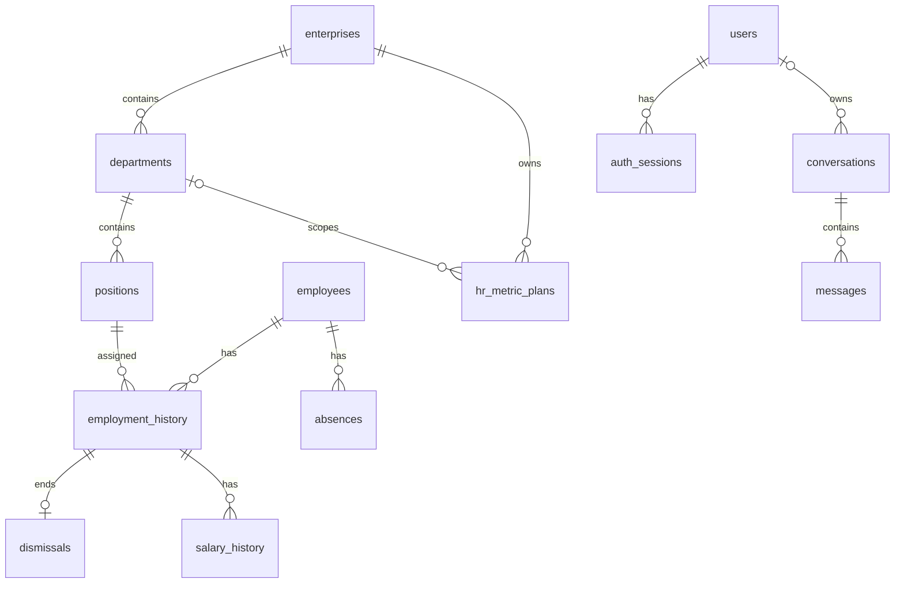

# HR Benchmarking

FastAPI и PostgreSQL для расчёта текучести кадров и хранения личной истории диалогов.

## Запуск

Нужны Python 3.9+ и PostgreSQL 15+. Запускайте команды из корня проекта.

```bash
python3 -m venv .venv
source .venv/bin/activate
python -m pip install -r requirements.txt
docker compose up -d --wait db
python -m alembic upgrade head
python -m uvicorn backend.main:app --reload
```

Откройте [интерфейс API](http://127.0.0.1:8000/docs). Если PostgreSQL уже запущен, пропустите команду Docker Compose. По умолчанию используется `postgresql+psycopg://hr:hr@localhost:5432/hr_benchmarking`. Для другого подключения задайте `DATABASE_URL`.

Для ручной проверки можно загрузить [временные демоданные](temporary_demo_data/README.md). Каталог с генератором удаляется после перехода на импорт CSV.

## Доступ пользователей

Доступ получают активные аккаунты из таблицы `users`. Домен email может быть любым. Аккаунты добавляются из терминала.

```bash
python -m backend.manage_users add name@example.com
python -m backend.manage_users disable name@example.com
python -m backend.manage_users enable name@example.com
```

Команда `add` запрашивает пароль от 15 до 128 символов. В PostgreSQL сохраняются хеши паролей Argon2id и хеши токенов сессий. Отключение аккаунта завершает его сессии и сохраняет диалоги.

## API

Все пути в таблице начинаются с `/api/v1`. Для запросов после входа передайте `Authorization: Bearer <access_token>`. Сессия действует 24 часа.

| Метод и путь | Назначение |
|---|---|
| `POST /auth/login` | Принимает `email` и `password`, возвращает токен сессии. |
| `GET /auth/me` | Возвращает профиль текущего пользователя. |
| `POST /auth/logout` | Завершает текущую сессию. |
| `POST /conversations` | Создаёт диалог текущего пользователя. |
| `GET /conversations` | Возвращает личные диалоги от недавно обновлённых к старым. |
| `GET /conversations/{conversation_id}` | Возвращает личный диалог и его сообщения по порядку. |
| `POST /conversations/{conversation_id}/messages` | Сохраняет `{"question": "Вопрос"}` в личной истории и возвращает сообщение с кодом `202`. |
| `PATCH /messages/{message_id}` | Меняет отметку сохранения по полю `is_saved`. |
| `GET /enterprises` | Возвращает предприятия. |
| `GET /enterprises/{enterprise_id}/departments` | Возвращает подразделения предприятия. |
| `GET /metrics` | Возвращает каталог HR-показателей. |
| `GET /metrics/turnover` | Рассчитывает месячную текучесть и сравнивает её с планом. |

Неверные данные входа и истёкшая сессия дают `401`. Для чужого диалога или сообщения API возвращает `404`. Схемы запросов и ответов доступны в `/openapi.json`.

### Расчёт текучести

Укажите `enterprise_id` и первый день месяца в `period`. Необязательный `department_id` задаёт подразделение.

Текучесть равна числу увольнений, делённому на среднюю дневную численность и умноженному на 100%. При расчёте численности учитываются все календарные дни и включается дата окончания трудоустройства. План берётся для выбранного предприятия или подразделения. Отклонение возвращается в процентных пунктах. Без плана оба поля содержат `null`. При нулевой численности статус — `insufficient_data`.

## База данных

Миграции создают HR-таблицы, аккаунты, сессии и личную историю. Сообщения хранятся вместе с отметкой сохранения. Сохранённые планы и результаты анализа возвращаются как JSON. Для исторических диалогов без установленного владельца миграция оставляет `user_id` пустым.



Модели и ограничения описаны в `backend/models.py`. Миграция `0001` создаёт исходную схему, а `0002` добавляет аккаунты, сессии и связь диалога с владельцем.

## Проверка

Для тестов используйте отдельную базу и укажите её в `DATABASE_URL`.

```bash
python -m pip install -r requirements-dev.txt
python -m alembic upgrade head
```

Загрузите [контрольный набор демоданных](temporary_demo_data/README.md), затем запустите проверки.

```bash
python -m unittest discover -s tests -v
python -m alembic check
```

## Следующие этапы

- Добавить загрузку CSV заказчиком и импорт кадровых данных в PostgreSQL.
- Добавить расчёт остальных HR-показателей и сравнение предприятий, подразделений, периодов и планов. Внутренние переводы учитываются отдельно от найма и увольнений. Уровень отсутствий рассчитывается по плановым рабочим дням.
- Подключить анализ вопросов. LLM предлагает параметры расчёта, а бэкенд проверяет их и считает показатели. Внешняя LLM получает разрешённые агрегаты по группам достаточного размера.
- Реализовать просмотр таблиц и экспорт разрешённых данных в CSV и XLSX.
