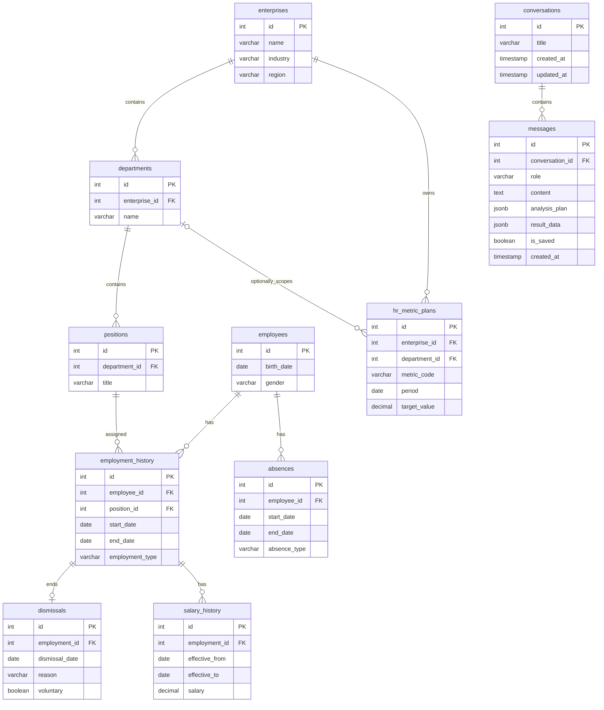

# Архитектура backend

## 1. HR-показатели

| Показатель | Расчёт |
|---|---|
| Численность на дату | Число действующих сотрудников по `employment_history` |
| Средняя численность за период | Среднее ежедневной численности |
| Принято сотрудников | Новые трудоустройства, без внутренних переводов |
| Уволено сотрудников | Количество увольнений за период |
| Текучесть кадров | Уволено / средняя численность × 100% |
| Доля добровольных увольнений | Добровольные / все увольнения × 100% |
| Средняя зарплата | Среднее действующих окладов за период |
| Изменение средней зарплаты | Разница между периодами |
| Уровень отсутствий | Дни отсутствий / плановые рабочие дни × 100% |
| Средний стаж | Средний стаж действующих сотрудников |

Анализ: сравнение предприятий и подразделений, динамика по периодам, факт относительно плана, поиск существенных отклонений. Изменение процентных показателей показывается в процентных пунктах (п. п.). Правила существенности задаются в аналитическом модуле.

## 2. Схема БД



| Таблица | Содержимое |
|---|---|
| `enterprises`, `departments`, `positions` | Предприятия, подразделения и должности |
| `employees` | Сведения о сотрудниках |
| `employment_history` | Периоды работы, переводы, повторный найм |
| `dismissals` | Даты и причины увольнений |
| `salary_history` | История окладов, привязанная к периоду трудоустройства |
| `absences` | Отпуска, больничные и другие отсутствия |
| `hr_metric_plans` | Плановые значения показателей по предприятию или подразделению и периоду |
| `conversations` | Диалоги и их названия |
| `messages` | Вопросы, ответы, планы анализа, данные таблиц/графиков, признак сохранения |

`department_id = NULL` в `hr_metric_plans` означает план предприятия целиком. Для подразделения используется его собственный план; смешивать уровни нельзя. Для одного показателя, периода и уровня планирования должна быть только одна актуальная запись.

При переводе сотрудника закрывается предыдущая запись `employment_history` и создаётся новая. Внутренние переводы не считаются наймом или увольнением. Для отсутствий и зарплаты учитывается принадлежность к подразделению на дату расчёта.

## 3. Структура backend

```text
backend/
├── api/
│   ├── routes.py                 # Ручки диалогов, анализа, справочников и сохранения ответов
│   └── schemas.py                # Схемы запросов, планов анализа и ответов API
├── services/
│   ├── analysis_orchestrator.py  # Процесс анализа, контекст и уточняющие вопросы
│   ├── llm_service.py            # Function Calling: план анализа и текстовый вывод
│   ├── analytics_service.py      # Универсальные операции с HR-показателями
│   ├── significance_service.py   # Правила поиска существенных отклонений
│   ├── conversation_service.py   # История диалогов, сообщения и сохранение
│   └── response_service.py       # Формирование JSON для текста, таблиц и графиков
├── repositories/
│   ├── hr_repository.py          # Первичные HR-данные и планы из БД
│   └── conversation_repository.py # Чтение и запись диалогов и сообщений
└── models/
    ├── hr.py                     # Модели HR-таблиц и плановых значений
    └── conversation.py           # Модели conversations и messages
```

| Класс | Основные методы |
|---|---|
| `AnalysisOrchestrator` | `analyze(conversation_id, question)`, `continue_analysis(conversation_id, question)` |
| `LLMService` | `build_plan(question, context)`, `generate_summary(result)` |
| `AnalyticsService` | `get_metric(...)`, `compare_entities(...)`, `compare_periods(...)`, `compare_with_plan(...)`, `get_trend(...)`, `check_data_availability(...)` |
| `SignificanceService` | `detect_deviations(result)` |
| `HRRepository` | `get_enterprises()`, `get_departments(...)`, `get_employment_history(...)`, `get_dismissals(...)`, `get_salary_history(...)`, `get_absences(...)`, `get_metric_plans(...)` |
| `ConversationService` | `create_conversation()`, `get_history()`, `get_messages()`, `save_message()`, `set_saved()` |
| `ConversationRepository` | `create(...)`, `list(...)`, `get_messages(...)`, `insert_message(...)`, `update_message(...)` |
| `ResponseService` | `build_response(...)`, `build_table(...)`, `build_chart(...)` |

**Поток:** вопрос → загрузка контекста последнего анализа → `LLMService.build_plan()` → проверка аргументов → `AnalyticsService` / `SignificanceService` → `LLMService.generate_summary()` → `ResponseService` → сохранение ответа → frontend.

LLM выбирает операцию и параметры через Function Calling, но не формирует SQL и не вычисляет показатели. Если в вопросе недостаточно данных (например, не указана метрика), возвращается `clarification_needed` с уточняющим вопросом. Если данных в БД недостаточно — `insufficient_data`. Для продолжения диалога используется предыдущий план анализа. Во внешнюю LLM отправляются только разрешённые агрегированные результаты, с исключением малых групп.

## 4. API для frontend

| Метод | Путь | Назначение |
|---|---|---|
| `POST` | `/api/v1/conversations` | Создать диалог |
| `GET` | `/api/v1/conversations` | Список диалогов для боковой панели |
| `GET` | `/api/v1/conversations/{id}` | Сообщения диалога с сохранёнными результатами |
| `POST` | `/api/v1/conversations/{id}/messages` | Отправить вопрос / ответить на уточнение и запустить анализ |
| `PATCH` | `/api/v1/messages/{id}` | Сохранить / убрать сохранение ответа (`is_saved`) |
| `GET` | `/api/v1/enterprises` | Получить список всех предприятий с их ID и названиями |
| `GET` | `/api/v1/enterprises/{id}/departments` | Получить список подразделений конкретного предприятия с их ID и названиями |
| `GET` | `/api/v1/metrics` | Доступные HR-показатели |
| `GET` | `/api/v1/data/tables` | Получить список доступных пользователю таблиц БД |
| `GET` | `/api/v1/data/tables/{table_name}/rows?page=1&page_size=50` | Получить строки выбранной таблицы с пагинацией, включая названия столбцов и общее количество строк |
| `GET` | `/api/v1/data/tables/{table_name}/export?format=csv` | Скачать все разрешённые строки выбранной таблицы в CSV |
| `GET` | `/api/v1/data/tables/{table_name}/export?format=xlsx` | Скачать все разрешённые строки выбранной таблицы в Excel |


Пример запроса:

```json
{"question": "Сравни текучесть предприятий за сентябрь 2026 года с планом"}
```

Пример успешного ответа (числа иллюстративные):

```json
{
  "status": "completed",
  "message_id": 42,
  "summary": "На «Севере» максимальное превышение плана: +1,9 п. п.",
  "visualization": {
    "default_view": "table",
    "table": {
      "columns": [
        {"key": "enterprise", "label": "Предприятие"},
        {"key": "actual", "label": "Факт, %"},
        {"key": "planned", "label": "План, %"},
        {"key": "deviation", "label": "К плану, п. п."}
      ],
      "rows": [
        {"enterprise": "Север", "actual": 8.4, "planned": 6.5, "deviation": 1.9},
        {"enterprise": "Юг", "actual": 6.2, "planned": 6.0, "deviation": 0.2}
      ]
    },
    "chart": {
      "type": "bar_chart",
      "title": "Текучесть за сентябрь, %",
      "x_key": "enterprise",
      "series": [
        {"key": "actual", "label": "Факт"},
        {"key": "planned", "label": "План"}
      ],
      "data": [
        {"enterprise": "Север", "actual": 8.4, "planned": 6.5},
        {"enterprise": "Юг", "actual": 6.2, "planned": 6.0}
      ]
    }
  }
}
```

Frontend отображает таблицу или график по `visualization`, без генерации HTML со стороны LLM. Переключение «Таблица / График» выполняется на frontend **без повторного вызова LLM**. Таблица и график могут отсутствовать, если визуализация не подходит к ответу.

Если нужны уточнения:

```json
{"status": "clarification_needed", "question": "Какой показатель и за какой период сравнить?"}
```

Если расчёт невозможен:

```json
{"status": "insufficient_data", "message": "Нет данных за выбранный период."}
```

Результаты анализа сохраняются в `messages.result_data` и повторно отображаются при открытии истории диалога.
